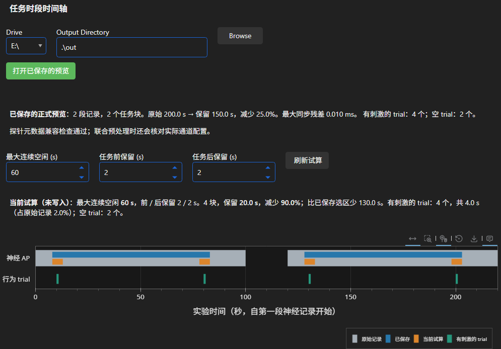

# Getting Started: Run the UI & Preprocess Your Data

This tutorial walks you through installing pynpxpipe, launching the Web UI, and running the preprocessing pipeline on SpikeGLX recordings.

## Prerequisites

- **Python 3.11 or 3.12** (3.13 is not supported)
- **uv** package manager ([install guide](https://docs.astral.sh/uv/getting-started/installation/))
- **SpikeGLX recording data** (a session directory containing `imec0/`, `imec1/`, ... subdirectories with `.ap.bin`/`.ap.meta` files, plus a NIDQ `.bin`/`.meta` pair)
- **MonkeyLogic BHV2 file** (the `.bhv2` behavioral data file for the same session)
- (Optional) **NVIDIA GPU** with CUDA for Kilosort4 spike sorting

## 1. Install pynpxpipe

You have two installation modes depending on your use case.

### Mode A — Consume as a dependency (most users)

Step 1 — add pynpxpipe to your own uv project:

```bash
# Recommended: full pipeline (Web UI + GPU detection + plots)
uv add "pynpxpipe[ui,gpu,plots] @ git+https://github.com/GongZhengxin/pynpxpipe.git"

# Add the LLM help assistant on top
uv add "pynpxpipe[ui,gpu,plots,chat] @ git+https://github.com/GongZhengxin/pynpxpipe.git"

# Core only (no UI, no plots)
uv add git+https://github.com/GongZhengxin/pynpxpipe.git
```

Step 2 — install the sort stack (**once**, not repeated on every update):

```bash
# Grab install_sort_stack.py from the repo (skip if you cloned in Mode B)
curl -O https://raw.githubusercontent.com/GongZhengxin/pynpxpipe/main/tools/install_sort_stack.py
curl -O https://raw.githubusercontent.com/GongZhengxin/pynpxpipe/main/tools/cuda_matrix.yaml
mkdir -p tools && mv install_sort_stack.py cuda_matrix.yaml tools/

# Interactive install — auto-detects your GPU + driver, recommends a CUDA wheel
uv run python tools/install_sort_stack.py
```

> **Why a separate step?** `torch` and `kilosort` are intentionally NOT listed
> in `pyproject.toml`. If they were, every `uv sync` would revert a CUDA build
> of torch back to the pypi CPU wheel, and you'd silently run on CPU again.
> Keeping them out of pyproject means the wheel you pick sticks across
> updates, and each user installs the wheel matching their own CUDA version.
>
> The installer reads `tools/cuda_matrix.yaml` to pick the right wheel for
> your driver. It always shows the recommendation first, then lets you
> confirm or override. Re-running it is idempotent (a lock file at
> `.venv/.gpu_stack_lock.json` records what was installed).

### Mode B — Clone for development / contribution

```bash
git clone https://github.com/GongZhengxin/pynpxpipe.git
cd pynpxpipe
uv sync --inexact --all-groups

# One-time sort stack install (see Mode A step 2 for why)
uv run python tools/install_sort_stack.py
```

To confirm the install at any later time:

```bash
uv run python tools/verify_gpu.py
```

### Keeping torch installed across future syncs

After the installer runs, **always pass `--inexact` when re-syncing**:

```bash
uv sync --inexact --extra ui --extra gpu --extra plots         # preserves torch/kilosort
uv sync --extra ui --extra gpu --extra plots                   # ✗ DON'T — removes torch
```

Why: `uv sync` defaults to strict mode and uninstalls anything not in `uv.lock`.
Since `torch` / `kilosort` live outside the lock (that's how CUDA builds stay
put per-user), strict sync nukes them. `--inexact` tells uv to leave
out-of-lock packages alone. As of uv 0.8 there is no environment-variable
equivalent, so you must pass the flag explicitly (or bake it into a shell
alias / Makefile).

If you see `ModuleNotFoundError: No module named 'torch'` after a `uv sync`,
you forgot `--inexact` — just re-run the installer (`--force` to skip prompts):

```bash
uv run python tools/install_sort_stack.py --yes --force
```

### Verify the installation

```bash
uv run pynpxpipe --version
uv run pynpxpipe --help
```

## 1b. Deploy to a New Machine (full install checklist)

Use this when standing up pynpxpipe on a fresh machine for production
preprocessing. **Full** means every runtime extra (UI + GPU detection + plots +
chat); only `matlab` is skipped (it needs a MATLAB install).

Prerequisites: Python 3.11/3.12 (not 3.13), uv, NVIDIA driver (for Kilosort4).

```bash
git clone https://github.com/GongZhengxin/pynpxpipe.git
cd pynpxpipe

# Full sync — --inexact is mandatory; do NOT use --all-extras (it would pull matlab)
uv sync --inexact --all-groups --extra ui --extra gpu --extra plots --extra chat

# One-time sort stack (picks a CUDA wheel for your GPU + driver)
uv run python tools/install_sort_stack.py

# Self-check
uv run python tools/verify_gpu.py     # must report cuda=True, no MISMATCH
uv run pynpxpipe --help
uv run pynpxpipe-ui                    # browser opens http://localhost:5006
```

Three things that bite on a fresh machine:

1. **Every later `uv sync` must pass `--inexact`** — otherwise the CUDA torch
   you just installed is replaced by the PyPI CPU wheel and sorting silently
   falls back to CPU.
2. **Long recordings (> ~2 h) risk a DREDge OOM** — the motion advisor (on by
   default) auto-tunes for this; see the note below.
3. **Offline / air-gapped machines** need the repo + wheel cache pre-staged
   (install pulls from GitHub + PyPI + pytorch.org).

> **NWB completeness note:** producing a self-contained NWB that can later be
> re-preprocessed from the single file (phase_shift recoverable) requires the
> `inter_sample_shift` / geometry / `.ap.meta` persistence fix (commit
> `687f2a3`). Deploy a branch that contains it (landed on `main` 2026-06-26).

### Long recordings (> ~2 h): DREDge memory

DREDge's peak memory is the `(B, T, T)` float32 cross-correlation matrices it
builds during motion estimation, where `B` is the number of nonrigid windows and
`T = duration / bin_s` (default `bin_s = 1 s`). Memory therefore scales
~`B · (duration / bin_s)²` — quadratic in duration, and largely independent of
firing rate. A 5.2 h dual-probe session OOM'd on 91 GB this way.

pynpxpipe's **motion advisor** (`motion_correction.auto_strategy`, on by default)
predicts this before preprocess and either raises `bin_s` to the highest temporal
precision that still fits available RAM, or — if even the coarsest acceptable
`bin_s` won't fit — disables DREDge and falls back to Kilosort4's internal
`nblocks` drift correction. So a long run "just works" on a big machine and
degrades gracefully on a tight one. See `docs/specs/motion_memory_advisor.md`.

To control it manually (advisor off, or to override): raising `bin_s` cuts the
matrix memory by `1/bin_s²` at the cost of drift time-resolution; or switch to
nblocks (mutually exclusive with DREDge):

```yaml
# pipeline.yaml — coarser DREDge bin (¼ the memory at bin_s=2), or disable it
motion_correction:
  bin_s: 2.0
  # method: null   # disable DREDge entirely instead
# sorting.yaml — KS4 internal drift blocks (use when DREDge is disabled)
sorter:
  params:
    nblocks: 5
```

## 2. Prepare Your Data

### 2.1 SpikeGLX Session Directory

Your SpikeGLX recording folder should have this structure:

```
my_session_g0/
  my_session_g0_imec0/
    my_session_g0_t0.imec0.ap.bin
    my_session_g0_t0.imec0.ap.meta
    my_session_g0_t0.imec0.lf.bin      # optional
    my_session_g0_t0.imec0.lf.meta     # optional
  my_session_g0_imec1/                  # if multi-probe
    ...
  my_session_g0_t0.nidq.bin
  my_session_g0_t0.nidq.meta
```

### 2.2 BHV2 Behavioral File

The `.bhv2` file from MonkeyLogic for the same session. pynpxpipe reads it with a pure-Python parser (no MATLAB required).

### 2.3 Subject Configuration (YAML)

Create a YAML file for your subject (or use an existing one in `monkeys/`). Example — `monkeys/MaoDan.yaml`:

```yaml
Subject:
  subject_id: "MaoDan"            # required by DANDI
  description: "good monkey"      # free text
  species: "Macaca mulatta"       # required by DANDI
  sex: "M"                        # required by DANDI
  age: "P4Y"                      # ISO 8601 duration
  weight: "12.8kg"                # body weight with unit
```

### 2.4 Output Directory

Choose a directory for processed output. pynpxpipe will create subdirectories for checkpoints, preprocessed data, sorting results, sync tables, and the final NWB file.

## 3. Launch the Web UI

The Web UI is the easiest way to configure and run the pipeline.

```bash
uv run pynpxpipe-ui
```

This starts a local Panel server and opens the UI in your default browser (typically at `http://localhost:5006`).

Alternatively, you can serve it manually:

```bash
uv run panel serve src/pynpxpipe/ui/app.py --show
```

### UI Overview

The UI has three sections, accessible from the sidebar:

| Section | Purpose |
|---------|---------|
| **Configure** | Set input paths, subject metadata, pipeline parameters, sorting options, and select stages. Subject forms can now be saved as reusable YAML files. |
| **Execute** | Start/stop the pipeline, monitor stage-level and probe-level progress, view real-time logs |
| **Review** | Load previous sessions, inspect checkpoint status, reset stages for re-run, browse generated figures via the **Figures Viewer**, and ask questions via the **Chat Help** panel (requires `chat` extra + API key) |

## 4. Configure a Pipeline Run (via UI)

### Step 1: Session Form

In the **Configure** section, fill in:

- **Session Directory** — path to your SpikeGLX recording folder (e.g., `D:/data/my_session_g0/`)
- **BHV File** — path to the `.bhv2` file (e.g., `D:/data/my_session.bhv2`)
- **Output Directory** — where to write results (e.g., `D:/output/my_session/`)

### Step 2: Subject Metadata

Fill in the subject fields (or load from a YAML file):

- **Subject ID** — unique identifier (e.g., `MaoDan`)
- **Species** — binomial name (e.g., `Macaca mulatta`)
- **Sex** — `M`, `F`, `U`, or `O`
- **Age** — ISO 8601 duration (e.g., `P4Y` for 4 years)
- **Weight** — with unit (e.g., `12.8kg`)

### Step 3: Pipeline Parameters

Adjust processing parameters (defaults are usually fine):

| Parameter | Default | Description |
|-----------|---------|-------------|
| **n_jobs** | auto | Number of parallel threads |
| **chunk_duration** | auto | Processing chunk window (e.g., `1s`) |
| **max_memory** | auto | Memory ceiling for logging |
| **Bandpass freq_min** | 300 Hz | High-pass cutoff |
| **Bandpass freq_max** | 6000 Hz | Low-pass cutoff |
| **Motion correction** | dredge | `dredge`, `kilosort`, or disabled |

### Step 4: Sorting Parameters

| Parameter | Default | Description |
|-----------|---------|-------------|
| **Mode** | local | `local` (run Kilosort4) or `import` (load external results) |
| **nblocks** | 15 | Drift correction blocks (0 = disabled) |
| **do_CAR** | false | Always false (preprocessing already does CMR) |
| **batch_size** | auto | Auto-detected based on GPU VRAM |

### Step 5: Select Stages

Choose which stages to run. The full pipeline order is:

1. **discover** — scan SpikeGLX folder, detect probes
2. **synchronize** — time alignment across IMEC, NIDQ, and BHV2 for each source
3. **select_segments** — choose task blocks and persist the source/time mapping
4. **preprocess** — filter each block, remove common bad channels, CMR, optional motion correction, save Zarr
5. **sort** — one Kilosort4 run per probe (or import compatible external results)
6. **merge** — optional unit merging
7. **curate** — quality metrics and unit classification on independent observation segments
8. **postprocess** — waveform analysis and SLAy scores
9. **export** — assemble one NWB with real acquisition gaps

For preprocessing only, select **discover** + **preprocess**. When task selection
or multiple sources are enabled, alignment and selection run automatically first.

### Task cropping and multiple recording pairs

In **Pipeline Parameters → 任务时段截取**, new GUI runs enable **只处理任务时段**.
The defaults merge trials separated by at most 180 seconds of idle time, then
retain 30 seconds before and after each task block. Idle time is measured from
the preceding trial's end. Keep the whole trial if an image onset was recorded,
even if fixation subsequently failed. Empty trials split blocks and limit padding.

在 **Configure → Session Paths** 顶部选择 **单段记录 / 多段联合**。
单段模式只使用单段路径；多段模式只使用配对表中已经保存的记录。
切换模式保留已填写内容，但隐藏模式的输入不参与执行。

**两段记录合并 sorting 的具体操作：**

1. 选择 **多段联合**。
2. 在“神经记录目录”中选一段 SpikeGLX gate 目录：里面应直接包含
   `*.nidq.bin`、`*.nidq.meta` 和 `*_imec0/` 子目录。
   不要选日期总目录，也不要进入 `_imec0` 或选择 `.ap.bin` 文件。
3. 单独选择这段对应的 `.bhv2`，点击 **添加配对**。
4. 选择第二段的神经目录和 BHV2，再点 **添加配对**。表中必须有至少两行，
   按实际采集顺序排列。选中一行后可 **编辑所选配对 → 保存修改**，或 **上移 / 下移**。
   输入框只是草稿，只有添加或保存后才会更新执行使用的配对。
5. 填写统一的 **Output Directory**、**Experiment**、日期、动物信息和探针脑区。
   **Detect Date** 从配对表第一段的元数据读取日期。输出目录选择独立的处理结果目录。
6. 在 **Pipeline Parameters → 任务时段截取** 设置采集时区；中国采集一般填
   `Asia/Shanghai`。启用 **只处理任务时段** 可先对齐，再按任务时段裁剪。
7. 进入 **Execute**，点击 **对齐并预览任务时段**，核对保留时段、时长和同步残差。
   此按钮只执行发现、对齐和时段选择，不执行预处理或 sorting。
8. 预览无误且兼容检查通过后，在执行 sorting 的电脑点击 **Run**。
   每支探针将两段选中数据联合 sorting 一次，结果中的 unit IDs 跨段共享。

例如以下布局应配对 `recording_g0 ↔ task.bhv2`、`recording_g1 ↔ task_2.bhv2`
（配对仍须根据实际实验记录核实，不能只凭文件名）：

```text
data/261109/
  recording_g0/                 ← 第一行神经目录选择这里
    recording_g0_t0.nidq.bin
    recording_g0_t0.nidq.meta
    recording_g0_imec0/         ← 不要选到这一层
      recording_g0_t0.imec0.ap.bin
      recording_g0_t0.imec0.ap.meta
  recording_g1/                 ← 第二行神经目录选择这里
    ...
  task.bhv2                    ← 第一行行为文件
  task_2.bhv2                   ← 第二行行为文件
```

两段应来自同一动物、同一天、同一实验，且探针插入位置及配置未改变。
程序自动读取 `imDatPrb_sn`（兼容旧字段 `imProbeSN`），无需手填序列号。
预览会报告联合处理的元数据兼容状态；不兼容时仍可查看对齐时段，
但正式联合预处理/sorting 会拒绝执行。实际通道顺序、坐标和增益也会在联合预处理时核对。

Set **采集时区 (IANA)** to the acquisition site's timezone, for example
`Asia/Shanghai`, if SpikeGLX timestamps have no UTC offset. Restarted acquisitions
use their acquisition timestamps; optional **起始偏移秒** values correct the time
relative to the first source's imec0 zero. The first offset must be zero.
Wall-clock offsets do not imply hardware synchronization precision across restarts.

Click **对齐并预览任务时段** in Execute to inspect the selected blocks, original and
retained durations, reduction and alignment residual before running sorting.
Source files are read-only. Each probe is jointly sorted with shared unit IDs;
the exported NWB preserves real time gaps. The 0.1-second join guard is a configurable
engineering default, requiring validation with your data.

**如何在网页里比较两套截取参数？** 已经预览成功的记录无需为看图再做对齐。更新并重启
网页后，进入 **Execute → 任务时段时间轴**，在 **Output Directory** 选择上次预览的输出根目录
（直接包含 `session.json`、`03_segments` 和 `04_sync`），点 **打开已保存的预览**。这会恢复
该会话的配对、参数和图。**Review → Resume Session → Load Session** 也能恢复同一预览。
只有从未生成过预览的新会话才需要先点 **对齐并预览任务时段**。

- 上轨灰色是原始神经记录，蓝色是上次正式预览保存的区间，橙色是当前参数的试算区间。
  下轨绿色是**有刺激的 trial**：从开始到结束至少记录了一次图片呈现。呈现后失败仍保留；
  只有注视、只有计划图片或没有刺激开始事件的 trial 排除。悬停可查呈现张数。两段采集之间的空白
  表示没有记录，不计入“原始时长”或“减少比例”。横向滚轮缩放、拖动平移，悬停可看来源及起止秒数。
- 直接修改图上方的 **最大连续空闲 (s)**、**任务前保留 (s)**、**任务后保留 (s)**；
  与 **Configure → Pipeline Parameters → 任务时段截取** 中对应输入同步。把 180 改为 60 后，
  按 **Enter** 或点 **刷新试算**，核对 **当前试算** 中的 `60 s`、橙色选区、块数和时长。
  如果该阈值下选区相同，图形不会改变。无需刷新浏览器或再次对齐；试算不写文件。
- 空闲阈值按**上一 trial 结束到下一 trial 开始**的时间计算。默认间隔 ≤180 s 就连成一块，
  每块首尾各补 30 s；补完后重叠的块还会合并。启用截取时，空 trial 始终隔开任务块，补边也不会跨进去。
  可先将 180 改为 60，再单独把前后保留从 30 改为 5，看每一步实际多裁了多少。
  **拼接保护区**和**滤波上下文**不控制保留时长。
- 旧报告的蓝色区间和减少比例保持原样；橙色按有刺激的 trial 试算。选好后点 **对齐并预览任务时段** 正式保存；用原输出目录即可。正式预览在规则或参数变化时
  会归档旧结果并重新同步，完成后蓝色按新选区更新。确认后再在处理电脑点击 **Run**。



图为合成示例：将空闲阈值从 180 s 降到 60 s，块前后仍各保留 2 s。两段记录内各有一次
69 s 的等待，新阈值下不再连接；蓝色 2 块对应 150 s，橙色 4 块只保留 20 s。

预览运行期间，**Run** 和预览按钮变灰是正常的，避免重复启动；预览只运行
discover、synchronize、select_segments，不运行 sorting。同步扫描长记录时，
阶段日志之间可能有一段等待时间。出现 **Level 2 complete** / **Level 3 complete**
表示这些步骤已完成；出现 **stage_failed** 则本次任务已经失败，继续等待不会恢复。
界面应显示 **Status: failed** 并恢复按钮。

如果终端在 **Synchronize complete** 之后出现 `Acquisition timestamp has no timezone`，
同步已经完成，预览停在时段选择。SpikeGLX 的 `fileCreateTime` 有时只记录当地日期和钟点，
两次重启的记录需要用采集地点的时区放在同一条时间轴上。
在 **Configure → Pipeline Parameters → 任务时段截取 → 采集时区 (IANA)** 输入实际时区。
中国采集填 `Asia/Shanghai`，然后回到 **Execute** 再点 **对齐并预览任务时段**。
字段里灰色的示例文字是输入提示。新版会在同步开始前检查每段记录，并显示缺少时区的文件。

旧版 Windows UI 如出现 `Tcl_AsyncDelete` 且网页停止响应，按下节更新并重启服务。
在 **Review → Resume Session** 选择上次的 **Output Directory**，点 **Load Session**，
再填写采集时区。修改时区会触发运行签名更新，已有派生结果会归档到输出目录的
`.invalidated/`，再次预览会重新对齐。新版使用 Agg 在后台写同步诊断 PNG。

**BHV 试次起始码（留空自动推导）** 通常保持空白。程序从所有 BHV2 trial 的
首事件确定共同起始码，再通过 `sync.event_bits` 匹配 NIDQ 中同一事件。
独立 TTL 输出线的值不等于 BHV 事件码。例如本项目这批记录中，试次 TTL 的物理值
是 `2`，BHV 起始事件是 `9`，按默认事件位配置解码后对应 NIDQ 值 `4`。
修复后的日志会打印 `Full-trial anchors: BHV code=9 -> decoded NIDQ code=4`，
`trial_intervals.parquet` 保存两端的码值和锚点时间。

如果旧版本报 `missing/ambiguous full-trial timing or start marker 2`，请先按下面的
步骤更新并重启 UI，把起始码留空，再点击 **对齐并预览任务时段**。
旧实现仅改填 `9` 仍会错误地配到独立 TTL 上，因此必须更新代码。
本次 synchronize 失败的输出目录可以继续使用。更新后程序会自动将旧算法的派生
结果归档到 `.invalidated/` 并重新计算对齐，避免复用错误时间映射；原始数据不变。

### 在另一台电脑通过 GitHub 更新

在执行 sorting 的电脑上，先关闭旧 Web UI，在现有 Git checkout 中运行：

```powershell
git fetch origin
git switch main
git pull --ff-only origin main
uv run --no-sync pynpxpipe-ui
```

上述命令假定 `origin` 指向 `GongZhengxin/pynpxpipe`。
任务截取、多段联合、探针元数据兼容和 trial 起始事件配对修复统一从 `main` 更新。
若此前使用 `codex/task-segments-joint-recordings`，按上述命令切换到 `main` 即可。
重新启动 UI 后应能看到顶部“单段记录 / 多段联合”切换。
路径填写这台处理电脑实际可访问的路径；盘符可能与开发电脑不同。

本次修复不新增依赖。已配置好的环境可以使用 `--no-sync` 启动；如确实需要
同步依赖，使用 `uv sync --inexact --extra ui --extra gpu --extra plots`，保留另行
安装的 CUDA torch / Kilosort。代码更新不会自动启动 sorting。

## 5. Run the Pipeline

1. Click the sidebar **Execute** button to switch to the Execute section.
2. Click **Run**. The pipeline launches in a background thread (the UI stays responsive).
3. Monitor progress:
   - **Progress bar** — shows which stage is active and per-probe sub-progress
   - **Log viewer** — real-time structured logs with level filtering (INFO, WARNING, ERROR)
   - **Status** — idle / running / completed / failed
4. To stop early, click **Stop** (sets an interrupt flag; the current probe finishes before stopping).

## 6. Run via Command Line (Alternative)

If you prefer the CLI:

```bash
uv run pynpxpipe run \
  D:/data/my_session_g0 \
  D:/data/my_session.bhv2 \
  --subject monkeys/MaoDan.yaml \
  --output-dir D:/output/my_session \
  --experiment visual_task --date 261117 --probe imec0=V4 \
  --pipeline-config config/pipeline.yaml \
  --sorting-config config/sorting.yaml
```

Run only specific stages:

```bash
# Only discover + preprocess
uv run pynpxpipe run \
  D:/data/my_session_g0 \
  D:/data/my_session.bhv2 \
  --subject monkeys/MaoDan.yaml \
  --output-dir D:/output/my_session \
  --experiment visual_task --date 261117 --probe imec0=V4 \
  --stages discover --stages preprocess
```

For paired recordings, copy `config/recordings.example.yaml` and edit the ordered
source paths and session metadata. Relative paths resolve against that YAML file.
Enable cropping explicitly in your pipeline YAML (legacy configurations keep it off):

```yaml
task_windows:
  enabled: true
  max_idle_s: 180
  padding_before_s: 30
  padding_after_s: 30
  join_guard_s: 0.1
  filter_margin_s: 0.1
  recording_timezone: Asia/Shanghai
  trial_start_code: null  # infer from BHV markers; set explicitly if required
```

```powershell
uv run pynpxpipe run-recordings config/recordings.example.yaml --subject monkeys/MaoDan.yaml --output-dir D:/output/joint --pipeline-config config/pipeline.yaml --preview
# Repeat without --preview to process the selected data.
```

Python entry: `SessionManager.from_recordings_yaml(path, subject, output_dir)` or
`SessionManager.create_from_recordings([...], subject, output_dir, experiment=..., probe_plan=..., date=...)`,
followed by `PipelineRunner(session, pipeline_config, sorting_config).run()`.

Inspect `03_segments/summary.json` and `03_segments/segments.json` for selection
and mapping details. Input/configuration changes archive old results under
`.invalidated/`. External sorting imports require a `segment_signature.json`
containing `{"signature": "<signature from segments.json>"}` beside each probe's
sorter output. A selected-block NWB cannot replace the complete original recordings;
`verify-safe-to-delete` refuses to certify their deletion. The implemented open-source
building blocks and design references are listed in [the specification](docs/specs/task_segments.md).

**多段数据已经 Postprocess complete，只有 export 因刺激表失败？** 保留原始 BHV2、SpikeGLX 和整个输出目录。无需在网页重新点 Run，也无需重建已自动清理的 `01_preprocessed`。从采集机取得任务实际使用的刺激 TSV 和同目录的 `manifest.tsv`，原样放在处理机可读的同一目录。表中的行号代表图片身份，重新生成或用 Excel 另存都会改变哈希。

在处理电脑更新并重启 Web UI 后，直接进入 **Execute → 从已保存的结果继续 NWB 导出**，无需重新填写 Configure：

1. **已保存的输出目录**：点 Browse 或粘贴上次运行的输出目录。选打开后能看见 `session.json`、`checkpoints` 和 `06_postprocessed` 的那一层。
2. **刺激表目录**：选处理电脑能访问的刺激包目录。例如本次任务使用 `stim19k.tsv`，就选打开后能同时看见 `stim19k.tsv` 和 `manifest.tsv` 的文件夹。不要选单个文件或只含图片的文件夹。
3. 点 **检查导出条件**。这一步只读取原始输入和已保存的结果，不写 NWB。失败原因会出现在按钮下方；改好目录后再次检查。只有旧版任务提示缺少原配置时，才需补填当时配置的图片库路径。
4. 显示 **检查通过** 后，点同一区域的 **仅继续 NWB 导出**，无需点普通 Run。网页显示导出进度，完成后显示 `.nwb` 的完整路径。修改目录会使上次检查失效。

可选：习惯命令行的用户也可以在处理电脑的仓库目录中运行：

```powershell
$out = 'E:\output\joint'
$vault = 'D:\img_vault\stim19k'
uv run pynpxpipe resume-export $out --image-vault $vault --check-only
if ($LASTEXITCODE -eq 0) { uv run pynpxpipe resume-export $out --image-vault $vault }
```

`--check-only` 只核对保存的运行配置、原始文件签名、选区、后处理检查点和各段刺激包，不写 NWB。正式命令仅调用 export；完成标志为 `Export complete`。可以重复 `--image-vault` 提供多个包目录，同名文件只接受刺激表和相邻 manifest 的 SHA-256 都与该段 BHV2 一致的副本。旧版 `session.json` 没有保存图片库目录；如果出现输入签名不符且当时配置过图片库，请按原顺序逐项追加 `--recorded-vault '当时填写的路径'`，不要重置检查点。`rerun-derivatives` 不能恢复尚未写出 NWB 的导出。

Check pipeline status:

```bash
uv run pynpxpipe status D:/output/my_session
```

Reset a stage to re-run it:

```bash
uv run pynpxpipe reset-stage D:/output/my_session preprocess
```

## 7. Understanding Preprocessing Output

After running the **discover** and **preprocess** stages, your output directory will contain:

```
D:/output/my_session/
  session_info.json              # Session metadata (probe list, paths)
  logs/
    pipeline.jsonl               # Structured JSON Lines log
  checkpoints/
    discover.json                # Stage checkpoint
    preprocess_imec0.json        # Per-probe checkpoint
    preprocess_imec1.json        # (if multi-probe)
  01_preprocessed/
    imec0.zarr/                  # Zarr recording (chunked, memory-efficient)
    imec0/
      figures/                   # Optional preprocess QC figures
    imec1.zarr/                  # (if multi-probe)
```

### Preprocessing Steps (per probe)

The preprocess stage applies these steps in strict order:

| Step | Operation | Why |
|------|-----------|-----|
| 1 | **Phase shift** | Fix ADC multiplexing timing — MUST be first |
| 2 | **Bandpass filter** | 300-6000 Hz (configurable) |
| 3 | **Bad channel detection** | Coherence + PSD method |
| 4 | **Bad channel removal** | Remove detected bad channels |
| 5 | **Common median reference** | Global median subtraction |
| 6 | **Motion correction** | DREDge drift correction (optional) |
| 7 | **Save to Zarr** | Chunked format for downstream stages |

Each probe is processed serially. Memory is released between probes (`del` + `gc.collect()`), so even 400+ GB AP files can be processed on modest hardware.

## 8. Resume from Interruption

pynpxpipe has checkpoint-based resume. If the pipeline is interrupted:

**Via UI:**
1. Open the **Review** section
2. Use the **Session Loader** to browse your output directory
3. Click **Load** — it auto-fills all forms from the saved session
4. Switch to **Execute** and click **Run** — completed stages are automatically skipped

**Via CLI:**
```bash
# Just re-run the same command — completed stages are skipped automatically
uv run pynpxpipe run D:/data/my_session_g0 D:/data/my_session.bhv2 \
  --subject monkeys/MaoDan.yaml --output-dir D:/output/my_session
```

To force re-run a stage, reset its checkpoint first:

**Via UI:** In the **Review** section, use the **Status View** to reset a stage.

**Via CLI:**
```bash
uv run pynpxpipe reset-stage D:/output/my_session preprocess
```

## 9. Configuration Reference

### Pipeline Config (`config/pipeline.yaml`)

```yaml
resources:
  n_jobs: auto                   # "auto" or integer
  chunk_duration: auto           # "auto" or "1s", "2s", "0.5s"
  max_memory: auto               # "auto" or "32G"

preprocess:
  bandpass:
    freq_min: 300
    freq_max: 6000
  bad_channel_detection:
    method: "coherence+psd"
    dead_channel_threshold: 0.5
  common_reference:
    reference: "global"
    operator: "median"
  motion_correction:
    method: "dredge"             # "dredge" | "kilosort" | null
    preset: "nonrigid_accurate"
```

### Sorting Config (`config/sorting.yaml`)

```yaml
mode: "local"                    # "local" | "import"

sorter:
  name: "kilosort4"
  params:
    nblocks: 15
    Th_learned: 7.0
    do_CAR: false                # Always false (preprocess handles CMR)
    batch_size: auto
```

### Subject Config (`monkeys/*.yaml`)

```yaml
Subject:
  subject_id: "MaoDan"
  description: "good monkey"
  species: "Macaca mulatta"
  sex: "M"
  age: "P4Y"
  weight: "12.8kg"
```

## 10. Troubleshooting

| Problem | Solution |
|---------|----------|
| `ModuleNotFoundError: No module named 'panel'` | Install UI extra: `uv sync --inexact --extra ui` |
| `ModuleNotFoundError: No module named 'torch'` | Run `uv run python tools/install_sort_stack.py` (torch lives outside pyproject; see install guide) |
| `The dredge method require torch: pip install torch` | Same — run the sort stack installer; DREDge needs `torch` |
| `ModuleNotFoundError: No module named 'kilosort'` | Same — run the sort stack installer |
| `TorchEnvError: torch_device='cuda' was requested ... CPU-only build` | Your torch is the CPU wheel. Run `uv run python tools/install_sort_stack.py --force` and pick a CUDA wheel matching your driver |
| `TorchEnvError: torch_device='cuda' was requested but no NVIDIA GPU` | Set `torch_device: cpu` (or `auto`) in `config/sorting.yaml` |
| `pynpxpipe-ui` command not found | Run via `uv run pynpxpipe-ui` or install with `uv sync --inexact` |
| UI doesn't open in browser | Navigate manually to `http://localhost:5006` |
| Out of memory during preprocess | Reduce `chunk_duration` (e.g., `"0.5s"`) or lower `n_jobs` in `pipeline.yaml` |
| Out of memory on a long session (> ~2 h) during motion correction | DREDge's `(B,T,T)` correlation matrices scale ~`(duration/bin_s)²`. The motion advisor (`auto_strategy`, on by default) auto-raises `bin_s` or falls back to `nblocks`; if it's off, set `motion_correction.bin_s` higher or `method: null` + `sorter.params.nblocks: 5` (see §1b) |
| Motion correction + KS4 nblocks conflict | These are mutually exclusive. Set motion correction to `null` if using KS4 nblocks > 0, or set nblocks to 0 if using DREDge |
| GPU not detected for sorting | Install GPU extra: `uv sync --inexact --extra gpu`. Ensure CUDA drivers are installed |
| Pipeline stuck on a stage | Check `logs/pipeline.jsonl` for errors. Use `reset-stage` to clear the checkpoint and retry |
| BHV2 parsing errors | pynpxpipe uses a pure-Python parser by default. Set `BHV2_BACKEND=matlab` to use MATLAB Engine as fallback (requires MATLAB) |
